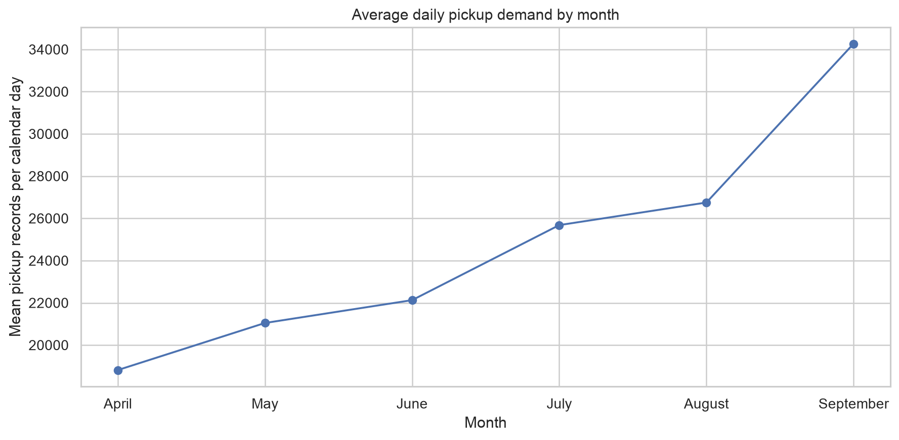
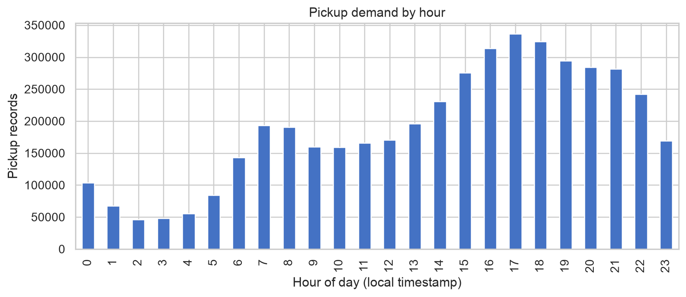
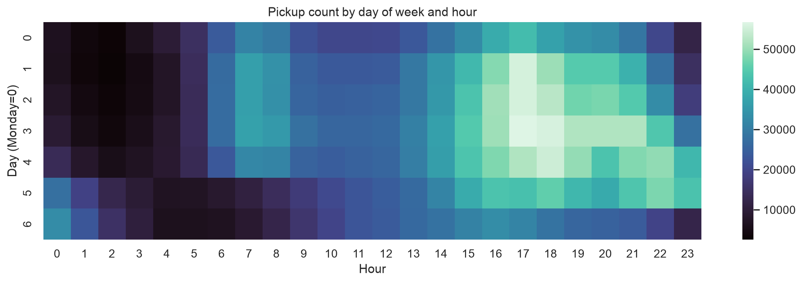
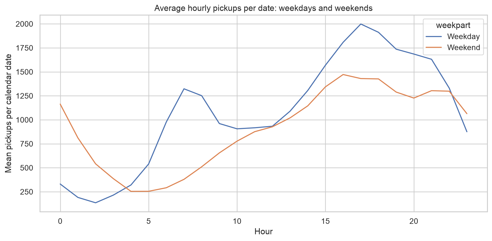
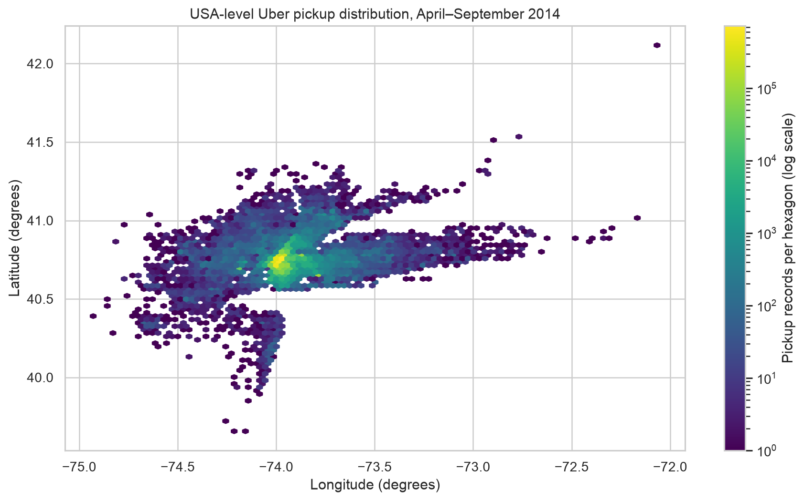
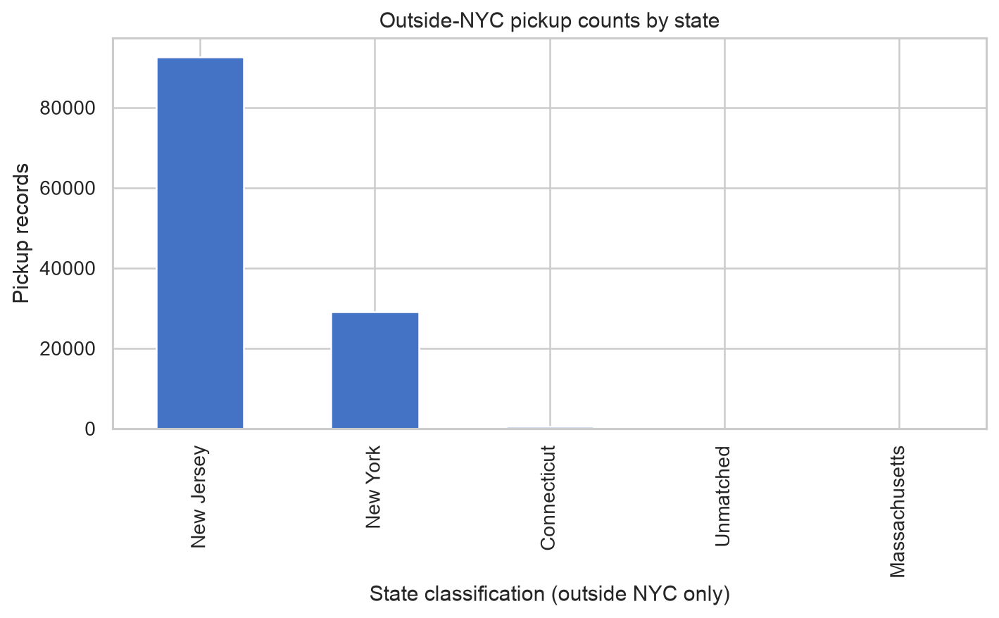
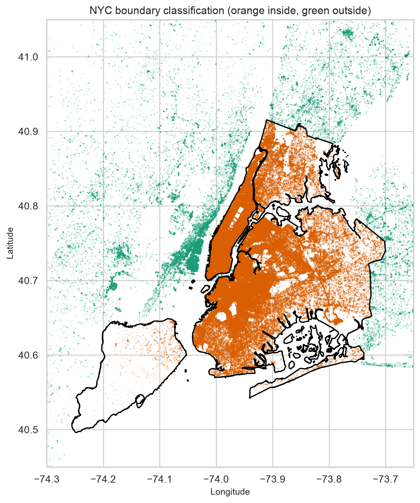
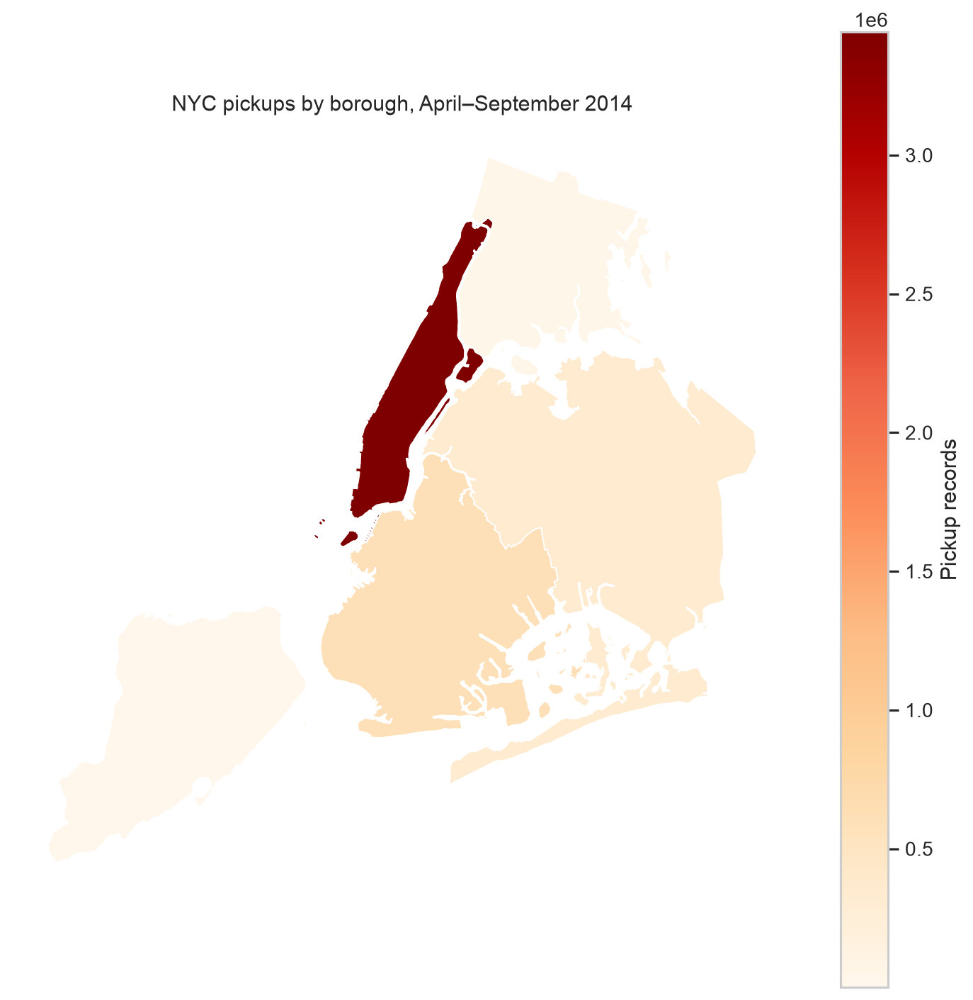
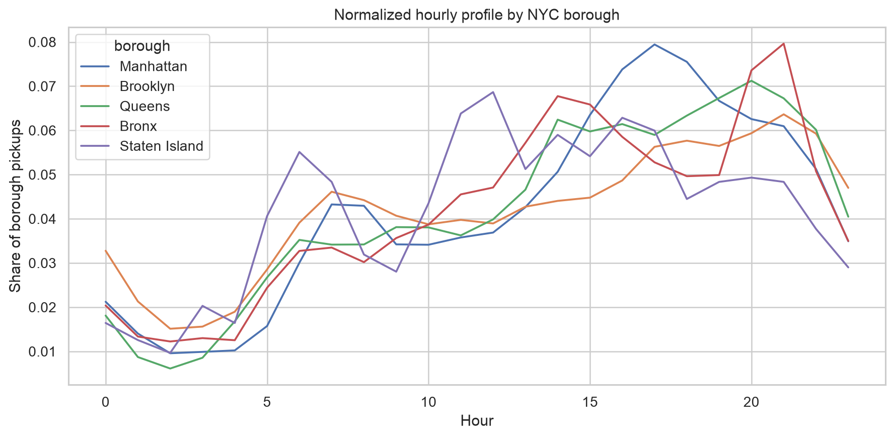
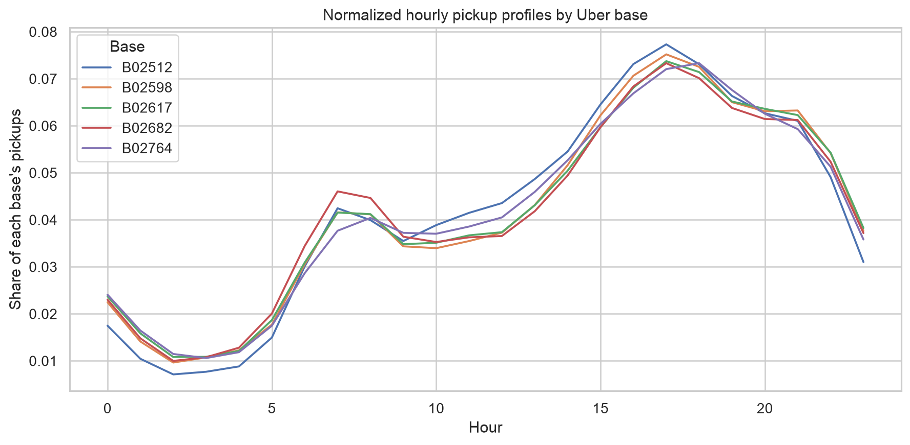

# Uber Pickup Demand Analysis 2014
**Study period:** April to September 2014
**Course:** Data Science, Year 2 Semester 1  
**Team:** Student 1: ____________________ | Student 2: ____________________  
**Academic context:** Reproducible course research project
## Abstract
This study examines 4,534,327 Uber pickup records from April through September 2014. The pipeline validates six monthly files, retains all observed rows, and applies a top-down geographic procedure: NYC boundary membership is tested first, borough classification is limited to points inside NYC, and state classification is applied separately to points outside NYC. Results identify 4,411,894 NYC pickups (97.30%) and 122,433 outside NYC (2.70%). Manhattan accounts for 78.05% of NYC pickups. The busiest hour is 17:00 (336,190 records) and the lowest is 02:00 (45,865). September has the greatest total and average daily volume. Omnibus tests find statistically significant categorical associations with small to modest effect sizes. These records describe pickup activity only; they do not measure drivers, unserved requests, fleet size, or causal drivers of demand.
## Chapter 1: Introduction
### 1.1 Background
Timestamped, geocoded pickup records reveal when and where ride activity was observed. Their interpretation must remain within the limits of the recorded fields.
### 1.2 Problem Statement
This project characterizes temporal and geographic variation in the 2014 NYC Uber pickup data while preventing locations outside the city from being assigned to a borough.
### 1.3 Research Objectives
Measure monthly, daily, hourly, borough, state, and base distributions; validate source data and geographic joins; test selected categorical associations; and identify cautious operations implications.
### 1.4 Research Questions
When do pickups peak? Where are they concentrated? Which borough has the highest count? How do patterns vary by hour, weekday, month, and base? Are the categorical distributions associated?
### 1.5 Scope of Study
The study covers the six provided monthly CSVs, April-September 2014, and the provided NYC borough and 2014 US state polygons. No fare, trip destination, driver, or service-quality fields are available.
### 1.6 Expected Contributions
The project provides an executable analysis pipeline, top-down geographic classification, validation tables, figures, and research report.
## Chapter 2: Dataset and Data Understanding
### 2.1 Dataset Description
The six files contain 4,534,327 records, with each monthly count matching its expected value. Each record contains a timestamp, latitude, longitude, and Uber base identifier.
### 2.2 Dataset Structure and 2.3 Data Dictionary
| Field | Definition |
|---|---|
| Date/Time | Source pickup timestamp |
| Lat | Latitude, decimal degrees, EPSG:4326 |
| Lon | Longitude, decimal degrees, EPSG:4326 |
| Base | Uber base identifier |
| month_file | Source month |
| inside_nyc | Point in union of NYC borough polygons |
| borough | Borough label, only for NYC-inside points |
| state_outside_nyc | State label for outside-NYC points |
| state_geometry_audit_inside_nyc | Independent state audit for reconciliation |
| year/month/day/hour/date/day_of_week | Timestamp-derived calendar features; Monday=0 |

| Month | Rows | Exact duplicate rows | Missing cells | Invalid rows | File-month mismatches |
|---|---:|---:|---:|---:|---:|
| Apr | 564,516 | 7,749 | 0 | 0 | 0 |
| May | 652,435 | 10,075 | 0 | 0 | 0 |
| Jun | 663,844 | 10,686 | 0 | 0 | 0 |
| Jul | 796,121 | 14,152 | 0 | 0 | 0 |
| Aug | 829,275 | 15,882 | 0 | 0 | 0 |
| Sep | 1,028,136 | 24,037 | 0 | 0 | 0 |

### 2.4 Data Quality Assessment
All monthly row totals match expected counts, and every timestamp month agrees with its source file month. Required fields have zero missing values and zero invalid rows. April contains 7,749 exact repeated rows; duplicates also occur in later months. All records are retained because duplicates may be repeated pickups or source duplication and the local files provide no provenance to distinguish them. Raw CSVs are untouched. There are no observed points on the NYC boundary; all NYC-inside points map to one borough.
### 2.5 Limitations
The data represent recorded pickups, not all requests, unique drivers, available supply, completed rides, or market share. The period is six months in 2014. Duplicate rows and boundary resolution affect totals.
## Chapter 3: Methodology
### 3.1 Overall Workflow and 3.2 Preprocessing
The pipeline reads each CSV, validates row counts and required fields, derives timestamp fields, applies vectorized point-in-polygon operations, saves classified rows as Parquet, and writes summary tables and figures. No rows are removed.
### 3.3 Temporal Feature Engineering
The analysis extracts year, month, day, hour, weekday, and date. Monthly and weekday comparisons use per-calendar-date averages where unequal exposure would bias total counts.
### 3.4 Geographic Classification
Coordinates are treated as EPSG:4326. The NYC boundary is the union of the five supplied borough polygons. State polygons are from the provided 2014 Census cartographic shapefile. `contains` is used for interiors and `intersects` handles exact boundaries; zero observed points lie on the NYC boundary.
### 3.5 Top-Down Geographic Analysis
Every pickup is tested against NYC first. Borough classification is only performed for NYC-inside points. Outside-NYC records are classified separately to state polygons and reported as New York, New Jersey, Connecticut, other, or unmatched. A separate state polygon audit on NYC points is used only for reconciliation: 15 NYC-inside points do not intersect a state polygon. They remain eligible for borough analysis and are unmatched in state totals. This preserves the different boundary definitions rather than forcing totals to agree.
### 3.6 Statistical Methods
Pearson chi-square tests assess selected count-table associations; weekday goodness-of-fit expected counts are adjusted to the number of observed dates per weekday. Cramér's V and Cohen's w accompany test statistics. Significance level is alpha=0.05. Tests are omnibus with no post-hoc pairwise comparisons. The millions of pickups are not an independent random sample; temporal and spatial clustering can make p-values too small. Effect sizes and observed counts are emphasized.
### 3.7 Visualization Methods
Spatial density is shown as a logarithmic hexbin over the observed extent. NYC maps use the supplied polygons. Average-daily charts adjust for calendar-date exposure; borough hourly profiles show proportions within borough.
## Chapter 4: Exploratory Data Analysis
### 4.1 Overall Dataset Overview
Of 4,534,327 records, 4,411,894 (97.30%) are inside NYC and 122,433 (2.70%) are outside.
### 4.2 Temporal Analysis
September is highest by monthly total (1,028,136) and April lowest (564,516). Average daily pickups are highest in September (34,271) and lowest in April (18,817). Hour 17 has 336,190 records, the maximum; hour 2 has 45,865, the minimum. Mean daily count is highest on Thursday (29,044) and lowest on Sunday (18,853). These are observed associations and do not identify causes.

### 4.3 Spatial Analysis
Pickups are concentrated around NYC. The log-scaled hexbin shows counts per cell over the observed coordinate extent, not population-adjusted rates. Outside NYC, New Jersey has the largest count, followed by New York and Connecticut; one record is in Massachusetts.

### 4.4 NYC Borough Analysis
| Borough | Pickups | % of NYC pickups | % of all records |
|---|---:|---:|---:|
| Manhattan | 3,443,457 | 78.05% | 75.94% |
| Brooklyn | 593,595 | 13.45% | 13.09% |
| Queens | 342,224 | 7.76% | 7.55% |
| Bronx | 31,584 | 0.72% | 0.70% |
| Staten Island | 1,034 | 0.02% | 0.02% |

Manhattan has the most pickups. Brooklyn and Queens follow. Bronx and Staten Island counts are lower. Raw counts measure total observed volume; normalized hourly profiles compare timing shape while controlling for borough total size. Manhattan and Brooklyn peak at 17:00; Queens, Bronx, and Staten Island peak at 18:00.

### 4.5 Uber Base Analysis
| Base code | Provided label | Pickups | % of all records | Peak hour | Peak weekday |
|---|---|---:|---:|---:|---|
| B02512 | Unter | 205,673 | 4.54% | 17 | Thursday |
| B02598 | Hinter | 1,393,113 | 30.72% | 17 | Thursday |
| B02617 | Weiter | 1,458,853 | 32.17% | 17 | Thursday |
| B02682 | Schmecken | 1,212,789 | 26.75% | 17 | Thursday |
| B02764 | Danach-NY | 263,899 | 5.82% | 18 | Saturday |
| B02765 | Grun | 0 | 0.00% | - | - |
| B02835 | Dreist | 0 | 0.00% | - | - |
| B02836 | Drinnen | 0 | 0.00% | - | - |

B02617 has the largest observed total (1,458,853), followed by B02598 and B02682. The accompanying normalized hourly profile compares timing shape across bases; monthly counts are available in the reproducible output table. Three listed codes have zero rows. Base totals do not establish driver counts, fleet size, market share, or operational capacity.

## Chapter 5: Statistical Analysis
### 5.1-5.2 Hypotheses and Tests
For independence tests, H0 states the categorical variables are independent and H1 states they are associated. For weekday goodness-of-fit, H0 states the expected pickup counts are proportional to weekday-date exposure; H1 states at least one weekday rate differs. alpha=0.05.
### 5.3-5.4 Results and Effect Sizes
| Question | Test statistic | pickups | p-value | Effect size |
|---|---:|---:|---:|---:|
| Is hour associated with day of week? | chi-square=305,696.58 | 138 | <0.001 | Cramér's V=0.106 |
| Does month-hour distribution vary across months? | chi-square=12,423.44 | 115 | <0.001 | Cramér's V=0.023 |
| Does hourly pickup profile differ by borough? | chi-square=47,371.17 | 92 | <0.001 | Cramér's V=0.052 |
| Are Uber base and borough pickup distributions associated? | chi-square=16,095.66 | 16 | <0.001 | Cramér's V=0.030 |
| Does mean demand per calendar date differ by weekday? | chi-square=91,187.26 | 6 | <0.001 | Cohen's w=0.142 |

### 5.5 Interpretation
All omnibus tests reject H0 at alpha=0.05 (p<0.001). Hour-by-weekday association has V=0.106; month-by-hour V=0.023; borough-by-hour V=0.052; base-by-borough V=0.030. Weekday effect size is w=0.142 after exposure adjustment. Month-hour and base-borough effects are small despite tiny p-values, illustrating why effect size matters with millions of rows. These event-level tests are descriptive; autocorrelation, clustered locations, and retained duplicates challenge independence. The dataset covers the full set of supplied rows, so confidence intervals for a probability sample are not reported and generalization beyond these months is not supported.
## Chapter 6: Results and Discussion
### 6.1 Key Findings
The data are NYC-centered, with a strong Manhattan concentration and a late-afternoon hourly peak. September is highest by total and daily average. State totals reconcile when 64 state-polygon unmatched locations are retained as unmatched.
### 6.2 Temporal Demand Insights
The 17:00 peak and overnight low can guide further historical analysis. Weekday and weekend profiles differ, but the six-month 2014 profile should not be assumed to describe current travel.
### 6.3 Geographic Demand Insights and 6.4 Borough Differences
Manhattan has 3,443,457 pickups (78.05% of NYC pickups). Outside NYC, New Jersey has 92,649 records. These counts are not area- or population-normalized. Normalized hourly profiles reveal smaller differences in temporal shape than raw borough totals suggest.
### 6.5 Operational Implications
Historical planning could examine curb activity and congestion near Manhattan during late afternoon. The data do not indicate driver availability, wait times, or unmet demand, so they cannot determine dispatch needs. Any operational intervention requires linked supply and service outcomes.
### 6.6 Limitations
The analysis covers six months of 2014; duplicates are retained; boundary resolution affects edge classification; and base metadata is absent. Associations do not establish causation.
## Chapter 7: Conclusion and Recommendations
### 7.1 Summary and 7.2 Answers to Research Questions
The executed analysis includes 4,534,327 rows, of which 4,411,894 are inside NYC. Manhattan has the highest borough count; activity peaks at 17:00; September leads total and average daily demand. Base records vary but cannot represent driver or fleet totals. Omnibus tests identify associations with small to modest effect sizes.
### 7.3 Recommendations
Use these patterns to prioritize follow-up measurement in Manhattan and late-afternoon periods. Combine pickups with driver availability, requests, service times, traffic, and weather before operational decisions. Preserve top-down geographic classification and validate boundary provenance. Re-run on newer and longer datasets before applying the profile to current conditions.
### 7.4 Limitations and 7.5 Future Research
Future analyses should use longer time series, exposure-adjusted spatial rates, daily models accounting for autocorrelation, and linked trip and service outcomes. Confirm duplicate provenance and boundary lineage.
## References
1. Uber Technologies. (2014). *Uber pickup data, New York City, April-September 2014* [CSV files provided with project]. The local project contains no source URL or attribution metadata for these files.
2. U.S. Census Bureau. (2014). *Cartographic Boundary Shapefile, States, 1:500,000* [provided state boundary file]. https://www.census.gov/geographies/mapping-files/time-series/geo/carto-boundary-file.html
3. New York City borough boundaries. (2026 file version). *Borough_Boundaries_20261028.geojson* [provided file]. The file has no source or lineage metadata; source attribution should be confirmed by the team.
4. Cohen, J. (1988). *Statistical Power Analysis for the Behavioral Sciences* (2nd ed.). Lawrence Erlbaum Associates.
5. Pearson, K. (1900). On the criterion that a given system of deviations from the probable in the case of a correlated system of variables is such that it can be reasonably supposed to have arisen from random sampling. *Philosophical Magazine, 50*(302), 157-175.
## Appendices
### Appendix A: Geographic Reconciliation
| State category | Records | % of all records |
|---|---:|---:|
| New York | 4,441,067 | 97.94% |
| New Jersey | 92,649 | 2.04% |
| Connecticut | 546 | 0.01% |
| Massachusetts | 1 | 0.00% |
| Other classified states | 0 | 0.00% |
| Unmatched | 64 | 0.00% |
| **Total** | **4,534,327** | **100.00%** |

The single Massachusetts point is counted once. Unmatched total 64 comprises 49 outside NYC plus 15 inside NYC but unmatched to state polygons. The 15 are still borough-classified; no observations are discarded.
### Appendix B: Implementation
Code: `src/analysis.py`; classified data: `outputs/processed/pickups_classified.parquet`; tables: `outputs/tables/`; geography QA: `outputs/geographic/`; figures: `outputs/figures/`. Run `python src/analysis.py`, then `python src/build_report.py` from the project root.
