# รายงานการวิเคราะห์รูปแบบการรับผู้โดยสาร Uber ในนิวยอร์กซิตี

ช่วงข้อมูล: เมษายน–กันยายน ค.ศ. 2014

รายวิชา: Data Science ชั้นปีที่ 2 ภาคการศึกษาที่ 1

ผู้จัดทำ: ______________________________  |  ______________________________

## บทคัดย่อ

รายงานนี้วิเคราะห์ข้อมูลจุดรับ Uber จำนวน 4,534,327 รายการ จากเดือนเมษายนถึงกันยายน ค.ศ. 2014 โดยตรวจสอบคุณภาพข้อมูล สร้างตัวแปรเวลา และจำแนกพื้นที่แบบลำดับชั้น เริ่มจากตรวจขอบเขต NYC จากนั้นกำหนด borough ให้เฉพาะจุดที่อยู่ใน NYC ส่วนจุดนอกเมืองจำแนกระดับรัฐแยกต่างหาก พบจุดใน NYC 4,411,894 รายการ (97.30% ของข้อมูลทั้งหมด) และนอก NYC 122,433 รายการ (2.70%). Manhattan มีจำนวนสูงสุด 3,443,457 จุด หรือ 78.05% ของจุดใน NYC ชั่วโมงที่มีจำนวนสูงสุดคือ 17:00 (336,190 จุด) ผลทดสอบทางสถิติพบความสัมพันธ์ในหลายตาราง แต่ขนาดอิทธิพลมีตั้งแต่เล็กถึงปานกลาง และควรตีความโดยคำนึงถึงการกระจุกตัวของข้อมูลตามเวลาและพื้นที่ ข้อมูลนี้นับจุดรับที่บันทึกไว้ ไม่ได้วัดจำนวนคนขับ รถที่พร้อมให้บริการ หรือคำขอเดินทางที่ไม่ได้รับบริการ

## บทที่ 1 บทนำ

### 1.1 ที่มาและความสำคัญ

ข้อมูลพิกัดและเวลาของจุดรับช่วยให้เห็นรูปแบบการใช้บริการในแต่ละพื้นที่และช่วงเวลา แต่จำนวนจุดรับไม่เท่ากับจำนวนคำขอทั้งหมด จำนวนรถที่พร้อมให้บริการ หรือจำนวนผู้โดยสารที่เดินทางสำเร็จ

### 1.2 ปัญหาและคำถามวิจัย

ข้อมูลครอบคลุมพื้นที่รอบมหานครนิวยอร์ก การวิเคราะห์ borough จึงต้องตัดสินก่อนว่าจุดอยู่ใน NYC หรือไม่ เพื่อไม่ให้จุดนอกเมืองถูกจัดเป็น borough คำถามหลักคือจุดรับหนาแน่นที่สุดเมื่อใดและที่ใด borough ใดมีจำนวนสูงสุด และรูปแบบเปลี่ยนไปอย่างไรตามชั่วโมง วัน เดือน และ base

### 1.3 วัตถุประสงค์

- ตรวจสอบจำนวนแถว คุณภาพข้อมูล และความสอดคล้องระหว่างเดือนในชื่อไฟล์กับ timestamp
- ศึกษารูปแบบตามเดือน ชั่วโมง และวันในสัปดาห์
- จำแนกข้อมูลจากขอบเขต NYC ไปยัง borough และรัฐตามลำดับ
- เปรียบเทียบรูปแบบของ borough และ Uber base พร้อมรายงานผลทดสอบทางสถิติ

### 1.4 ขอบเขต

ใช้ไฟล์รายเดือน 6 ไฟล์ ตั้งแต่เมษายนถึงกันยายน ค.ศ. 2014 ขอบเขต borough มาจาก NYC Open Data รุ่นปี 2026 ส่วนขอบเขตรัฐเป็น Census ปี 2014 การใช้ขอบเขตคนละปีเป็นข้อจำกัดที่ต้องพิจารณาเมื่ออ่านผล

## บทที่ 2 ข้อมูลและคุณภาพข้อมูล

### 2.1 แหล่งข้อมูลและตัวแปร

แต่ละแถวประกอบด้วย Date/Time, Lat, Lon และ Base โดย FiveThirtyEight ระบุว่าได้รับข้อมูลจาก NYC Taxi & Limousine Commission (TLC) ผ่านคำขอข้อมูลสาธารณะ FOIL [1] ไฟล์มีข้อมูลเวลาจุดรับ พิกัด และรหัส base แต่ไม่มีปลายทาง ค่าโดยสาร หรือข้อมูลผู้ขับขี่

| เดือน | แถว | แถวซ้ำ | ค่าว่าง | แถวผิดรูปแบบ | เดือน timestamp ไม่ตรงไฟล์ |
| --- | --- | --- | --- | --- | --- |
| Apr | 564,516 | 7,749 | 0 | 0 | 0 |
| May | 652,435 | 10,075 | 0 | 0 | 0 |
| Jun | 663,844 | 10,686 | 0 | 0 | 0 |
| Jul | 796,121 | 14,152 | 0 | 0 | 0 |
| Aug | 829,275 | 15,882 | 0 | 0 | 0 |
| Sep | 1,028,136 | 24,037 | 0 | 0 | 0 |

### 2.2 ผลตรวจและการจัดการแถวซ้ำ

ข้อมูลทั้ง 6 ไฟล์รวม 4,534,327 แถว และจำนวนรายเดือนตรงตามค่าที่คาดไว้ ไม่พบค่าว่างหรือค่าผิดรูปแบบใน timestamp พิกัด และรหัส base เดือนของ timestamp ตรงกับเดือนของไฟล์ทุกแถว พบแถวซ้ำแบบตรงกันในทุกเดือน แต่เก็บไว้ทั้งหมดเพราะไม่มีรหัสเหตุการณ์ ที่จะชี้ได้ว่าแถวซ้ำเกิดจากการรับผู้โดยสารหลายครั้งในจุดและเวลาเดียวกัน หรือเกิดจากการคัดลอกข้อมูลซ้ำ ไฟล์ดิบไม่ได้ถูกแก้ไข

### 2.3 ข้อจำกัดของข้อมูล

ข้อมูลไม่สามารถใช้สรุปจำนวนคนขับ ขนาดกองรถ ส่วนแบ่งตลาด จำนวนคำขอที่ไม่ได้รับบริการ หรือสาเหตุของความต้องการเดินทางได้

## บทที่ 3 วิธีดำเนินการ

### 3.1 ขั้นตอนเตรียมข้อมูล

1. อ่าน CSV แยกตามเดือน ตรวจจำนวนแถว ค่าว่าง รูปแบบพิกัด base code และความสอดคล้องของเดือนใน timestamp
2. นับแถวซ้ำแบบตรงกันแต่ไม่ลบ และคงไฟล์ดิบไว้
3. แยก year, month, day, hour, date และ day_of_week (วันจันทร์มีค่า 0)
4. บันทึกข้อมูลที่ผ่านการจำแนกเป็น Parquet และสร้างตารางสรุปกับภาพจากข้อมูลชุดเดียวกัน

### 3.2 วิธีจำแนกภูมิศาสตร์แบบลำดับชั้น

พิกัดและ polygon ถูกใช้ในระบบ EPSG:4326 โดยใช้ contains_xy ตรวจจุดภายใน polygon และ intersects_xy ตรวจกรณีที่จุดอยู่บนเส้นขอบ [4] ขั้นตอนจำแนกคือ:
1. ตรวจทุกจุดกับ polygon รวมของ borough ทั้งห้า เพื่อกำหนดว่าอยู่ใน NYC หรืออยู่นอก NYC
2. ส่งเฉพาะจุดใน NYC ไปจำแนกเป็น Manhattan, Brooklyn, Queens, Bronx หรือ Staten Island
3. แยกจุดนอก NYC ไปตรวจ polygon รัฐ โดยเก็บ New York, New Jersey, Connecticut, รัฐอื่น และ unmatched
4. ตรวจจุด NYC กับ polygon รัฐอีกครั้งเพื่อการกระทบยอดเท่านั้น หากไม่ตรง polygon รัฐ จุดนั้นยังคงเป็นจุด NYC และยังอยู่ในการวิเคราะห์ borough

NYC Open Data ระบุว่าชุด borough boundaries ไม่รวมพื้นที่น้ำ [2] ส่วน polygon รัฐมาจาก Census ปี 2014 [3] จึงรักษาความแตกต่างของขอบเขตทั้งสองไว้ ไม่บังคับให้จำนวนตรงกัน

### 3.3 การวิเคราะห์เวลา พื้นที่ และ base

คำนวณยอดรายเดือน ชั่วโมง และวันในสัปดาห์ พร้อมใช้ค่าเฉลี่ยต่อวันเมื่อจำนวนวันไม่เท่ากัน แสดงรูปแบบร่วมของชั่วโมงกับวัน/เดือนด้วย heatmap ใช้ hexbin แบบสเกลลอการิทึม แสดงความหนาแน่นของจุด และใช้สัดส่วนภายใน borough/base เพื่อเปรียบเทียบรูปทรงของรูปแบบเวลา

### 3.4 วิธีทดสอบทางสถิติ

ใช้ Pearson chi-square กับตารางความถี่ และรายงาน Cramér’s V หรือ Cohen’s w เป็นขนาดอิทธิพล กำหนด alpha เท่ากับ 0.05 การทดสอบวันในสัปดาห์ปรับจำนวนคาดหมายตามจำนวนวันจริงในแต่ละ weekday (มีวันอังคาร 27 วัน และวันอื่นอย่างละ 26 วัน)

## บทที่ 4 ผลการสำรวจข้อมูล

### 4.1 ภาพรวม

มีจุดใน NYC 4,411,894 รายการ (97.30% ของข้อมูลทั้งหมด) และนอก NYC 122,433 รายการ (2.70%)

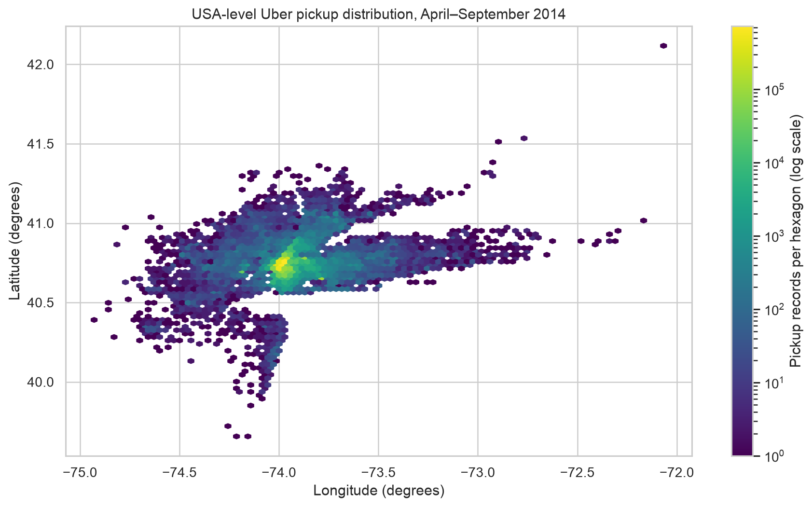

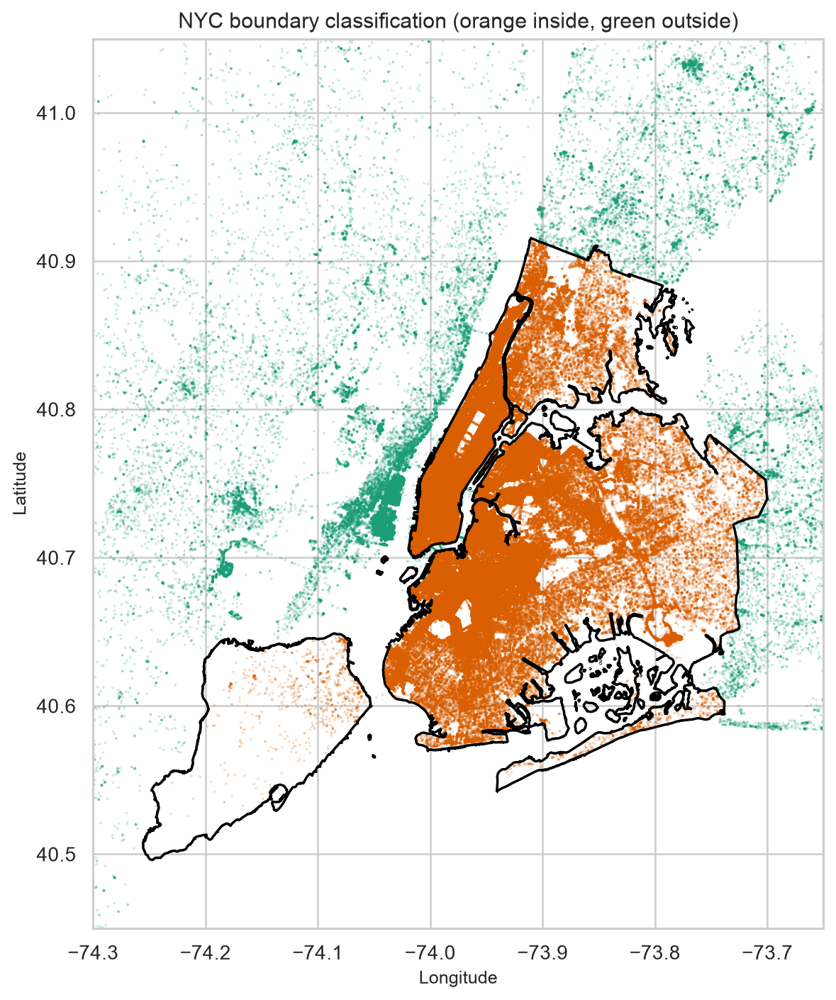

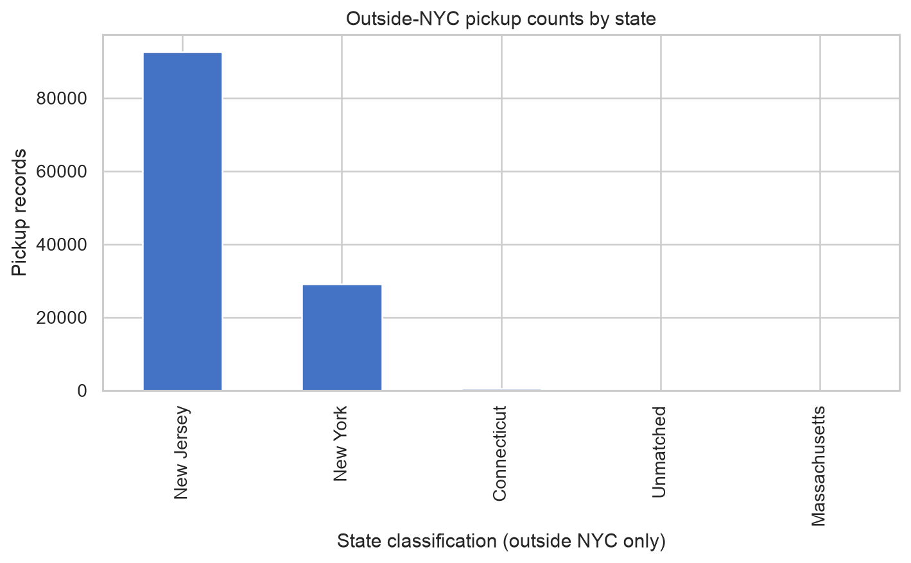

### 4.2 รูปแบบตามเวลา

กันยายนมีจำนวนรวมสูงสุด 1,028,136 รายการ และเมษายนต่ำสุด 564,516 รายการ เมื่อเฉลี่ยต่อวัน กันยายนยังสูงสุดที่ 34,271 จุดต่อวัน และเมษายนต่ำสุดที่ 18,817 จุดต่อวัน ชั่วโมง 17:00 มี 336,190 รายการ สูงสุด ส่วน 02:00 มี 45,865 รายการ ต่ำสุด ค่าเฉลี่ยรายวันสูงสุดในวันพฤหัสบดี (29,044) และต่ำสุดในวันอาทิตย์ (18,853)

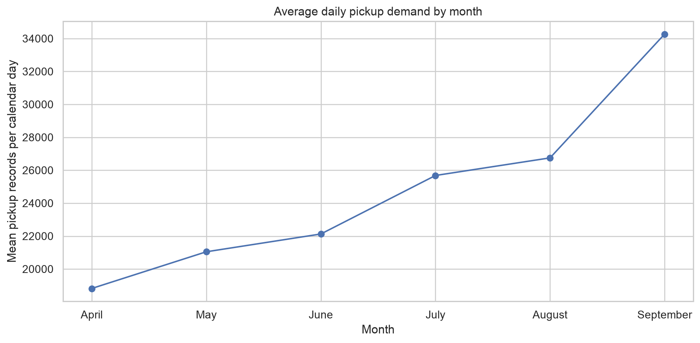

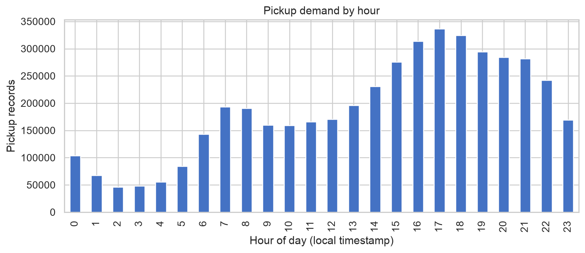

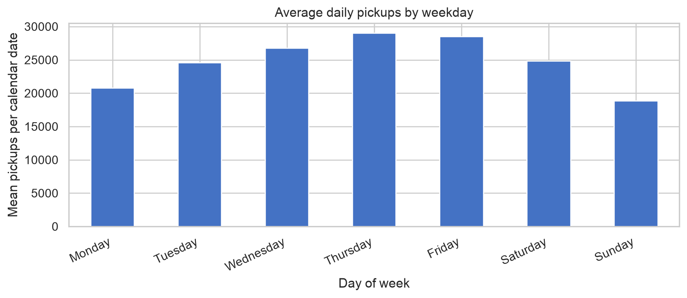

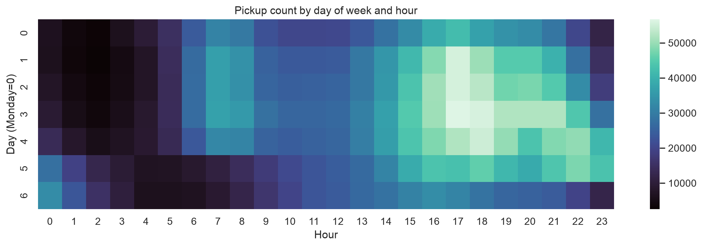

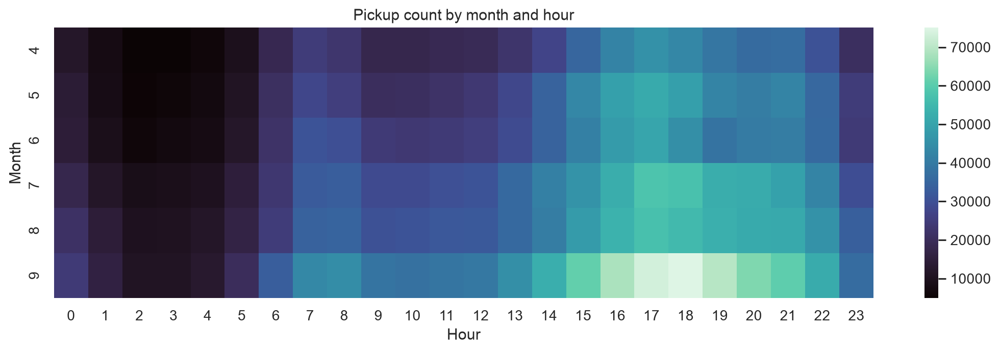

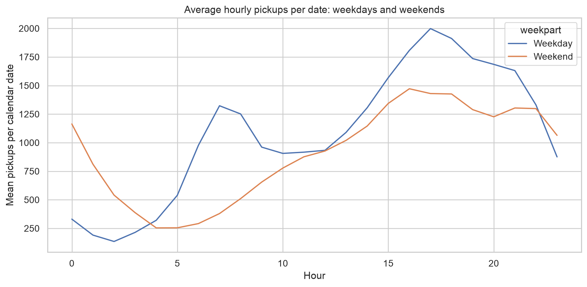

ข้อมูลแสดงว่าจำนวนจุดรับเพิ่มในช่วงบ่ายและสูงสุดช่วง 17:00 แต่ไม่ได้ระบุว่าสาเหตุเกิดจากตารางงาน กิจกรรม สภาพจราจร หรือจำนวนรถที่พร้อมให้บริการ

### 4.3 การเปรียบเทียบ borough

| borough | จำนวนจุดรับ | % ของจุดรับใน NYC | % ของข้อมูลทั้งหมด |
| --- | --- | --- | --- |
| Manhattan | 3,443,457 | 78.05% | 75.94% |
| Brooklyn | 593,595 | 13.45% | 13.09% |
| Queens | 342,224 | 7.76% | 7.55% |
| Bronx | 31,584 | 0.72% | 0.70% |
| Staten Island | 1,034 | 0.02% | 0.02% |

Manhattan มี 3,443,457 จุด หรือ 78.05% ของจุดใน NYC และ 75.94% ของข้อมูลทั้งหมด Brooklyn มี 593,595 จุด และ Queens 342,224 จุด ชั่วโมงสูงสุดราย borough คือ Bronx สูงสุดที่ 21:00; Brooklyn สูงสุดที่ 21:00; Manhattan สูงสุดที่ 17:00; Queens สูงสุดที่ 20:00; Staten Island สูงสุดที่ 12:00; จำนวนดิบใช้ดูปริมาณรวม ส่วนกราฟ normalized ใช้เปรียบเทียบรูปแบบเวลา

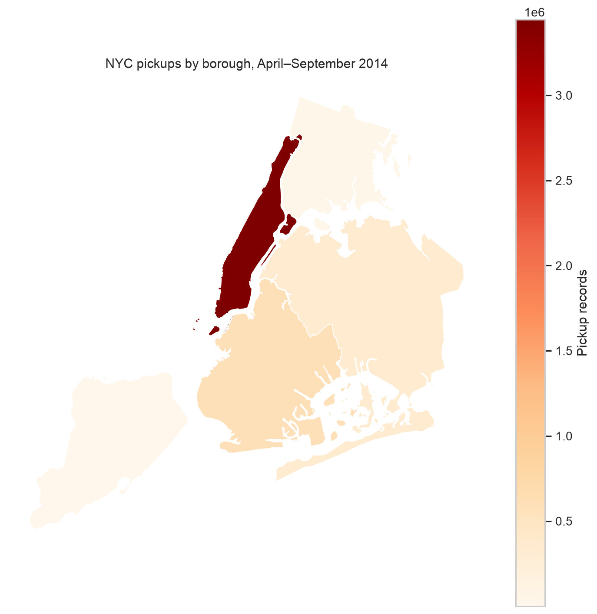

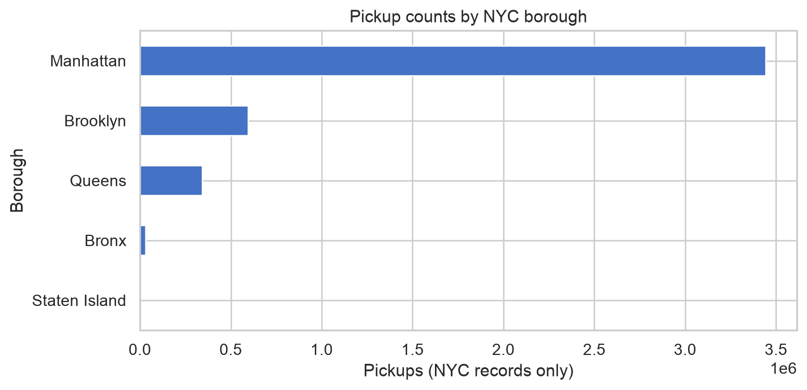

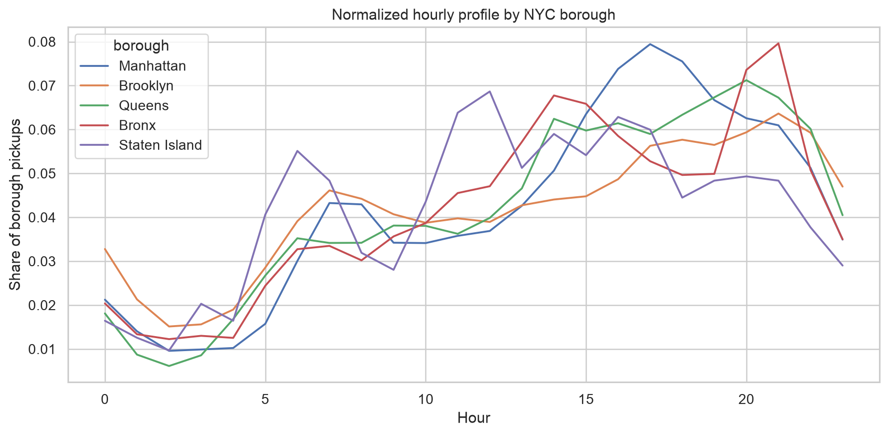

### 4.4 การเปรียบเทียบ Uber base

| รหัส | ชื่อ base | จำนวน | % ของข้อมูลทั้งหมด | ชั่วโมงสูงสุด | weekday สูงสุด |
| --- | --- | --- | --- | --- | --- |
| B02512 | Unter | 205,673 | 4.54% | 17 | วันพฤหัสบดี |
| B02598 | Hinter | 1,393,113 | 30.72% | 17 | วันพฤหัสบดี |
| B02617 | Weiter | 1,458,853 | 32.17% | 17 | วันพฤหัสบดี |
| B02682 | Schmecken | 1,212,789 | 26.75% | 17 | วันพฤหัสบดี |
| B02764 | Danach-NY | 263,899 | 5.82% | 18 | วันเสาร์ |
| B02765 | Grun | 0 | 0.00% | — | ไม่มีรายการ |
| B02835 | Dreist | 0 | 0.00% | — | ไม่มีรายการ |
| B02836 | Drinnen | 0 | 0.00% | — | ไม่มีรายการ |

B02617 มีจำนวนสูงสุด 1,458,853 รายการ ตามด้วย B02598 จำนวน 1,393,113 และ B02682 จำนวน 1,212,789 รหัส B02765, B02835 และ B02836 ไม่มีรายการ จำนวน record ของ base ไม่ใช่จำนวนคนขับ ขนาดกองรถ หรือส่วนแบ่งตลาด

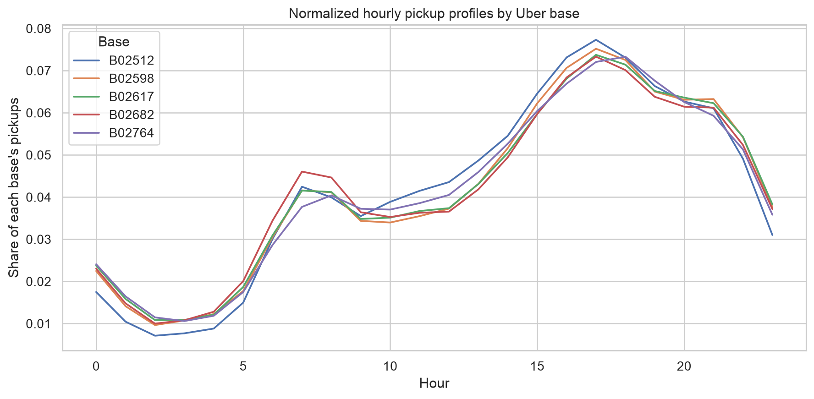

## บทที่ 5 ผลการทดสอบทางสถิติ

| คำถามที่ทดสอบ | ค่าสถิติ | df | p-value | ขนาดอิทธิพล |
| --- | --- | --- | --- | --- |
| Is hour associated with day of week? | χ² = 305,696.58 | 138 | < 0.001 | Cramér’s V = 0.106 |
| Does month-hour distribution vary across months? | χ² = 12,423.44 | 115 | < 0.001 | Cramér’s V = 0.023 |
| Does hourly pickup profile differ by borough? | χ² = 47,371.17 | 92 | < 0.001 | Cramér’s V = 0.052 |
| Are Uber base and borough pickup distributions associated? | χ² = 16,095.66 | 16 | < 0.001 | Cramér’s V = 0.030 |
| Does mean demand per calendar date differ by weekday? | χ² = 91,187.26 | 6 | < 0.001 | Cohen’s w = 0.142 |

สมมติฐานศูนย์ของการทดสอบความเป็นอิสระระบุว่าตัวแปรจัดหมวดหมู่ไม่มีความสัมพันธ์กัน ส่วนการทดสอบ weekday เปรียบเทียบจำนวนจริงกับค่าคาดหมายที่ปรับตามจำนวนวัน ผลทั้งห้าการทดสอบมี p-value ต่ำกว่า 0.001 แต่ค่า V อยู่ในช่วง 0.023–0.106 และ w เท่ากับ 0.142 แสดงว่าความแตกต่างบางรายการมีขนาดเล็ก แม้จะมีนัยสำคัญทางสถิติ

จุดรับจำนวนมากไม่ได้เป็นตัวอย่างสุ่มอิสระอย่างสมบูรณ์ เพราะอาจกระจุกตามวัน ชั่วโมง และพื้นที่ และมีแถวซ้ำอยู่ด้วย จึงรายงานขนาดอิทธิพลควบคู่กับ p-value และไม่สรุปเหตุและผล

## บทที่ 6 การกระทบยอดภูมิศาสตร์และอภิปราย

| ผลจำแนกระดับรัฐ | จำนวน | % ของข้อมูลทั้งหมด |
| --- | --- | --- |
| New York | 4,441,067 | 97.94% |
| New Jersey | 92,649 | 2.04% |
| Connecticut | 546 | 0.01% |
| Massachusetts | 1 | 0.00% |
| Other classified states | 0 | 0.00% |
| Unmatched | 64 | 0.00% |
| รวม | 4,534,327 | 100.00% |

ยอดรัฐรวมได้ 4,534,327 รายการ: New York 4,441,067; New Jersey 92,649; Connecticut 546; Massachusetts 1; unmatched 64; และรัฐอื่น 0 กลุ่ม unmatched 64 จุดประกอบด้วย 49 จุดนอก NYC ที่ไม่ตรง polygon รัฐ และ 15 จุดใน NYC ที่ไม่ตรง polygon รัฐ จุด 15 รายการยังอยู่ในการวิเคราะห์ borough ส่วนจุด Massachusetts นับเพียงครั้งเดียว

ผลที่ใช้วางแผนต่อได้คือการตรวจพื้นที่ Manhattan และช่วงปลายบ่ายเป็นพิเศษ แต่ข้อมูลนี้ไม่มีจำนวนรถที่พร้อมให้บริการ เวลารอ หรือคำขอที่ไม่ได้รับบริการ จึงยังใช้กำหนดจำนวนรถที่ควรจัดสรรไม่ได้

## บทที่ 7 สรุป ข้อจำกัด และข้อเสนอแนะ

ข้อมูลส่วนใหญ่อยู่ใน NYC โดย Manhattan มีจำนวนจุดรับสูงสุด รูปแบบตามเวลาสูงสุดที่ 17:00 และค่าเฉลี่ยต่อวันเพิ่มจากเมษายนถึงกันยายน การจำแนกแบบลำดับชั้นทำให้จุดนอกเมืองไม่ถูกนำไปนับใน borough

- ก่อนวิเคราะห์ borough ให้ตรวจขอบเขต NYC ก่อนทุกครั้ง และเก็บ unmatched ไว้ตรวจสอบ
- เชื่อมข้อมูลจำนวนรถพร้อมให้บริการ เวลารอ การจราจร และคำขอที่ไม่ได้รับบริการก่อนตัดสินใจด้านปฏิบัติการ
- ทำซ้ำกับข้อมูลหลายปีและ boundary รุ่นที่ตรงกับช่วงข้อมูล
- ตรวจที่มาของแถวซ้ำก่อนลบ เพราะไฟล์นี้แยกการซ้ำจากระบบกับเหตุการณ์จริงไม่ได้

ข้อจำกัดหลักคือข้อมูลมีเพียงหกเดือนของปี 2014; boundary borough เป็นรุ่น 2026 และไม่รวมพื้นที่น้ำ; boundary รัฐเป็นรุ่น 2014; ไม่มีข้อมูลปลายทางหรือจำนวนรถพร้อมให้บริการ; และเก็บแถวซ้ำไว้ ผลจึงไม่ควรถูกขยายไปยังปีอื่นโดยไม่มีข้อมูลเพิ่มเติม

## แหล่งข้อมูลและเอกสารอ้างอิง

[1] FiveThirtyEight. Uber TLC FOIL Response. ที่มา คำอธิบายข้อมูลรายเดือน ตัวแปร และรหัส base: https://github.com/fivethirtyeight/uber-tlc-foil-response
[2] NYC Department of City Planning. Borough Boundaries, NYC Open Data (อัปเดต 26 พฤษภาคม 2026; ไม่รวมพื้นที่น้ำ): https://data.cityofnewyork.us/City-Government/Borough-Boundaries/gthc-hcne
[3] U.S. Census Bureau. 2014 Cartographic Boundary Shapefiles: States, 1:500,000: https://www.census.gov/geographies/mapping-files/time-series/geo/carto-boundary-file.2014.html
[4] Shapely documentation: contains_xy และ intersects_xy สำหรับตรวจความสัมพันธ์ระหว่างพิกัดกับ geometry: https://shapely.readthedocs.io/en/2.2.0/reference/shapely.contains_xy.html
[5] Pearson, K. (1900). On the criterion that a given system of deviations from the probable in the case of a correlated system of variables is such that it can be reasonably supposed to have arisen from random sampling. Philosophical Magazine, 50(302), 157–175.
[6] Cohen, J. (1988). Statistical Power Analysis for the Behavioral Sciences (2nd ed.). Lawrence Erlbaum Associates.

## ภาคผนวก: วิธีทำซ้ำ

ข้อมูลดิบอยู่ในโฟลเดอร์ data; ตารางและกราฟอยู่ใน outputs; โค้ดวิเคราะห์อยู่ใน src/analysis.py ติดตั้งแพ็กเกจจาก requirements.txt แล้วรัน python src/analysis.py จากนั้นรัน python src/build_thai_report.py เพื่อสร้างรายงาน Markdown และ DOCX และใช้ LibreOffice แปลง DOCX เป็น PDF

